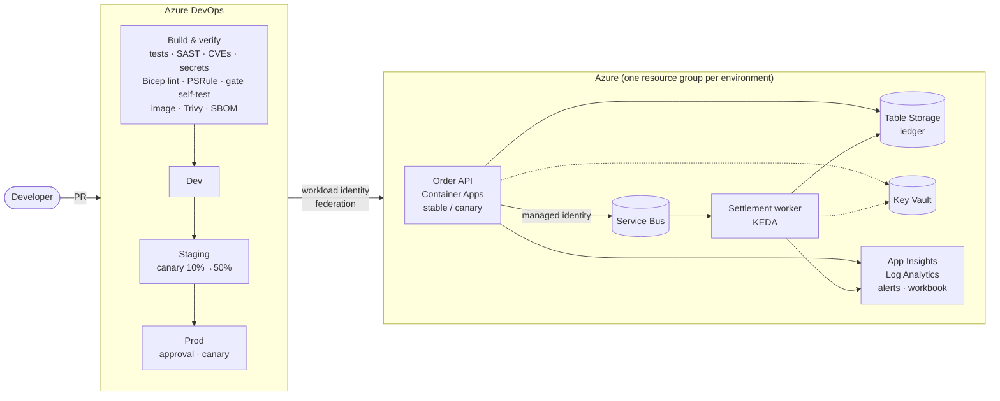

# Azure TradeOps

**An enterprise DevSecOps platform for a simulated trade-settlement service on Azure.**
Azure DevOps pipelines, Bicep and PowerShell take every commit from pull request to
production. Along the way the change is tested, scanned, policy-checked, deployed as a
canary, measured, and promoted or automatically rolled back.

The application is deliberately small: a FastAPI order API and a Service Bus settlement
worker. The project is the delivery platform around it.

| | |
|---|---|
| **CI/CD** | Azure DevOps multi-stage YAML: build → dev → staging canary → prod plan → approved prod canary |
| **Infrastructure** | Azure Bicep: 13 reusable modules, typed per-environment `.bicepparam` files, linter rules raised to errors, `what-if` change gate |
| **Release automation** | PowerShell module (`scripts/TradeOps`): pre-flight checks, canary analysis, promotion, rollback (39 Pester tests) |
| **Runtime** | Azure Container Apps (revisions, labelled traffic, KEDA), Service Bus, Table Storage, Key Vault |
| **Security** | Workload identity federation, managed identities only, no keys anywhere; PSRule at PR time, Azure Policy (Deny) at deploy time |
| **Observability** | OpenTelemetry → Application Insights, structured JSON logs, 5 alert rules, operations workbook |
| **Data (optional)** | Databricks bundle: Lakeflow declarative pipeline for settlement analytics, Spark-tested locally |

## The three things it demonstrates

### 1. Commit to production, fully gated
A merge to `main` runs five CI jobs (four in parallel, then the image): Python tests against an Azure Storage emulator,
SAST, dependency CVEs, full-history secret scanning, Bicep lint, PSRule for Azure,
PowerShell analysis, and an image build with Trivy and an SBOM. The image is then promoted
**by digest** through dev → staging → prod. Prod requires a manual approval inside a
business-hours window, and the approver first sees a Bicep `what-if` of exactly what will
change.

### 2. A failing release is detected and rolled back automatically
Each release lands as a new Container Apps revision at **0% traffic**. It is smoke-tested
through its own URL, then canaried at 10% and 50%. At each step, 60 synthetic orders
measure its error rate and p95 latency against the SLO and against the stable revision. A
failing verdict triggers an automatic rollback: one atomic traffic change back to
`stable`, the canary deactivated, and recovery verified from outside. Detection and
recovery times are written to a release report. The demo switch ships a release that fails
30% of orders **while passing every health probe**, the kind of failure liveness checks miss.

### 3. Unsafe changes are rejected, twice
PSRule for Azure (80 rules, 8 of them custom) blocks the PR. Azure Policy initiatives with a
**Deny** effect block the same change at deploy time, even from the portal. A **gate
self-test** applies 13 real unsafe changes to the infrastructure code on every run (shared
keys, HTTP ingress, SAS auth, public prod endpoints, SSH from the internet...) and fails
the build if any gets through. Its first run found a gap in the built-in rules, now closed
by a custom rule.

## Architecture



Request flow, release mechanics and design decisions: **[docs/architecture.md](docs/architecture.md)**.

## Verified results

Everything below was run on the code in this repository. Numbers are from those runs.

| Check | Result |
|---|---|
| Python tests: unit + Azure Tables SDK against Azurite | **74 passed**, 95% branch coverage (CI gate: 90%) |
| ruff, `mypy --strict`, bandit (medium+), pip-audit (`--strict`) | clean, clean, 0 findings, 0 known vulnerabilities |
| Bicep: 5 entrypoints, linter rules raised to errors | 0 errors, 0 warnings; 3 environment parameter files compile |
| PSRule for Azure (3 environments + 2 app templates) | **718 / 718 rule evaluations pass** (80 rules, 85 resources) |
| Security gate self-test | **13 / 13 unsafe changes rejected**, baseline passes |
| PowerShell: PSScriptAnalyzer / Pester | 0 findings / **39 passed** |
| Container image | 72 MB, non-root (UID 10001); Trivy: **0** fixable HIGH/CRITICAL |
| Smoke test against the containerised API on Azurite | 8 / 8 checks, including settlement end to end in about 2 s |
| Canary analysis against a live 30%-fault release vs. a healthy baseline (100 orders each) | **Fail** verdict: 28% errors (`201×72, 500×28`) vs. 0%; healthy release: **Pass**, p95 2.2 ms |
| Databricks transforms on local Spark (Java 21) | 6 passed; bundle files valid against the Databricks CLI schema |
| gitleaks over the working tree | no leaks |

That canary run also found a bug no mocked test caught: under `Set-StrictMode`, a 500
response body crashed the smoke test instead of failing it. It is fixed and now covered by
a regression test.

### Azure run evidence

**Not yet captured.** The platform has not yet been deployed to a live Azure subscription,
so pipeline durations, release and rollback timings, and dashboard screenshots are pending.
[docs/demo.md](docs/demo.md) lists exactly what to run and record. The release scripts
write these timings themselves (`release-report-<env>.json`, `rollback-report-<env>.json`).

| Metric | Value |
|---|---|
| Commit → prod (excluding approval wait) | *pending* |
| Build stage duration | *pending* |
| Failing release: time to detect / time to recover / traffic exposed | *pending* / *pending* / 10% by design |
| Unsafe change: PR blocked / policy denial | *pending screenshots* |

## Repository layout

```
app/                    FastAPI order API + settlement worker (Python 3.12, uv)
  src/tradeops/           risk checks, ledger, Service Bus, telemetry, fault injection
  tests/                  unit + Azurite integration tests
  Dockerfile              multi-stage, non-root, digest-promotable
infra/
  main.bicep              platform: network, monitoring, identity, KV, ACR, SB, storage, ACA env, alerts, workbook
  modules/                13 reusable modules
  apps/                   API (multi-revision, labelled traffic) and worker (KEDA) templates, deployed per release
  env/                    dev / staging / prod .bicepparam
  governance/             Azure Policy initiative (Deny) + assignments
  bootstrap/              resource groups, federated pipeline identities, ABAC-constrained RBAC
pipelines/
  azure-pipelines.yml     main CI/CD
  templates/              CI jobs, per-environment deploy (what-if → canary → rollback), Databricks stage
  databricks-pipeline.yml
scripts/
  TradeOps/               PowerShell module: platform, traffic, verification, release
  *.ps1                   pipeline entrypoints: Test-Environment, Deploy-Platform, Push-Image,
                          Deploy-Release, Invoke-SmokeTest, Invoke-Rollback, Get-ReleaseStatus,
                          Test-SecurityGates
  tests/                  Pester
.ps-rule/, ps-rule.yaml   PSRule config, custom TradeOps rules, scoped exceptions
monitoring/               workbook definition (generated by build_workbook.py)
databricks/               bundle: Lakeflow pipeline, synthetic data job, Spark tests
docs/                     architecture, setup, security, runbook, demos, cost
```

## Run it locally

Needs `uv`; PowerShell 7 and the Bicep CLI for the infra and script checks; Docker for the
image.

```bash
make setup
make run                      # API on :8080 with in-memory ledger and queue -> /docs
make test lint security       # Python gates
make bicep psrule gates       # infrastructure gates, including the 13-case self-test
make pester                   # release tooling
make compose                  # API + Azurite in containers
pwsh scripts/Invoke-SmokeTest.ps1 -BaseUrl http://localhost:8080
```

Try the failing release locally: `TRADEOPS_FAULT_RATE=0.3 make run`, then
`pwsh -c "Import-Module ./scripts/TradeOps/TradeOps.psd1; Measure-CanaryHealth -CanaryUrl http://localhost:8080"`.

## Deploy to Azure

About 30 minutes of one-time setup: providers, federated service connections,
`infra/bootstrap`, `infra/governance`, environments with approval checks, branch policy.
Then every merge to `main` deploys. Step by step:
**[docs/azure-devops-setup.md](docs/azure-devops-setup.md)**. Cost guidance (prod's Premium
SKUs are the bulk of it): [docs/cost.md](docs/cost.md).

## Operating it

[docs/runbook.md](docs/runbook.md) covers the release status view, one-command rollback
(`-ToPrevious` reverts a promoted release to a warm revision with no cold start), alert
playbooks and KQL queries. [docs/security.md](docs/security.md) maps every control to
where it is enforced and lists each accepted exception with its reason.

## Not done yet

- **Live Azure evidence** (above).
- **API authentication.** There is no end-user auth yet; next is Entra ID via Container Apps
  authentication.
- **Network.** Ingress is public so Microsoft-hosted agents can probe it. A bank deployment
  would use an internal environment behind Application Gateway WAF, a Managed DevOps Pool
  in the VNet, and NAT or firewall egress.
- **Supply chain.** Image signing (Notation) and admission verification.
