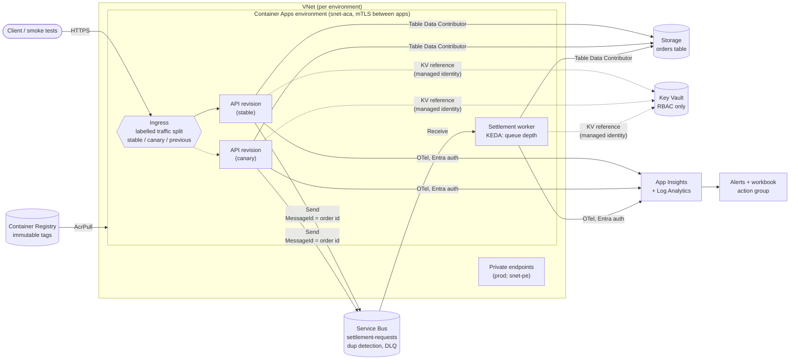
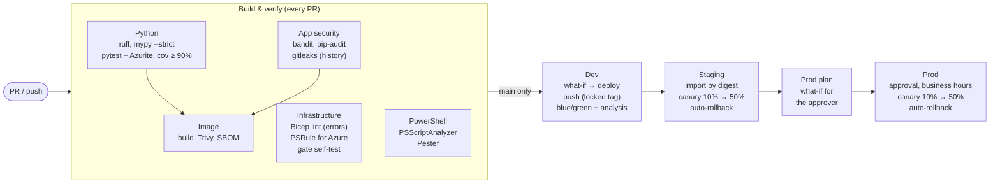

# Architecture

## Runtime

Every arrow into a data service is a managed identity with a data-plane role scoped to
that one resource. No connection string, SAS token, account key or registry password
exists anywhere: shared keys and local auth are disabled on Storage, Service Bus, App
Insights and Log Analytics, and the ACR admin user is off.

### Order flow

1. `POST /v1/orders`: schema validation (422 on malformed input), then pre-trade risk
   (account status, restricted list, ±10% price collar, per-account and platform notional
   limits). Every check runs and every failure is recorded.
2. The order is written to the ledger as `ACCEPTED` or `REJECTED`. Rejections are kept,
   because the audit trail matters more than storage.
3. Accepted orders are published to Service Bus with `MessageId = order id`. If the
   broker is down, the API answers 503 and the client retries with the same
   `client_order_id`. The replay re-publishes, and duplicate detection drops the copy.
4. The worker settles: commission (5 bps, $1 minimum, banker's rounding) and net cash. It
   is idempotent under at-least-once delivery. Malformed or unknown messages dead-letter
   immediately; transient failures retry up to `maxDeliveryCount` (5), then the order is
   marked `FAILED`, dead-lettered and alerted on.

Order ids are `uuid5(account_id/client_order_id)`, so a duplicate submission collides on
insert rather than creating a second order. Money is `Decimal` end to end and travels as a
string; it is never a float.

## Delivery

### Release mechanics (per environment)

| Step | What happens | Customer traffic on the new release |
|---|---|---|
| Pre-flight | `Test-Environment.ps1`: subscription, resource group, providers, Bicep, platform health | none |
| Platform | `what-if` → change gate (blocks deletes and protected-property changes) → deploy | none |
| Image | dev: push the CI-scanned image under a locked tag. Later stages: `az acr import` **by digest** from the previous stage | none |
| Deploy revision | `infra/apps/api.bicep` adds a revision at 0%, labelled `canary` | 0% |
| Ready | provisioned, running, readiness probe healthy | 0% |
| Smoke | 8 checks through the revision's own URL, including settlement end to end | 0% |
| Canary steps | traffic → 10%, analyse 60 synthetic orders vs. SLO and the stable baseline; then 50% | 10%, then 50% |
| Promote | new revision 100% `stable`; old revision kept warm at 0% as `previous`; older ones deactivated | 100% |
| Worker | worker rolled to the same digest; redeploys the previous image if it fails | n/a |
| Verify | smoke test through the public URL | 100% |

On failure at any step after the revision exists, `Invoke-CanaryRelease` rolls back on the
spot. It sends one merge-patch that puts 100% on `stable`, deactivates the canary, then
probes the public URL until every response comes from the stable revision, and records
detection and recovery times in the release report. The deployment job's `on: failure`
hook calls the same idempotent rollback as a safety net (agent loss, timeouts).
`Invoke-Rollback.ps1 -ToPrevious` reverts an already-promoted release in one command.

## Design decisions

**Container Apps rather than AKS.** Revisions, labelled traffic splitting, KEDA, managed
identity and VNet integration are built in. That covers everything this platform needs,
without a cluster to patch and operate. The release scripts depend only on revision and
traffic APIs, so the same canary logic would port to AKS with Flagger or Argo Rollouts.

**Platform and release are separate deployments.** `main.bicep` never declares container
apps, so an infrastructure change can never shift live traffic. App templates are deployed
per release with the current stable revision passed in, following the Microsoft Learn
blue-green pattern. The platform publishes its outputs as a contract that the release
tooling reads, so resource names are never recomputed outside Bicep.

**One primitive for traffic.** Every weight change, promotion and rollback is a single ARM
merge-patch of the whole traffic table (weights and labels together), followed by
verification. Nothing edits traffic incrementally, so there is no partial state to reason
about.

**Canary analysis from the outside.** Synthetic orders go to the canary's own URL, and each
response's `X-TradeOps-Revision` header proves which revision served it. The verdict is
therefore immediate and exact at any traffic weight, with no waiting on log ingestion.
Fault injection affects only `/v1/*`, so the failing release passes every health probe;
that is exactly the failure mode a liveness check misses.

**Build once, promote by digest.** CI builds and scans one image. Dev pushes it under a
locked tag, and staging and prod import that digest from the stage before. Prod runs the
exact bytes that passed staging's canary.

**Three layers of security control.** PSRule rejects unsafe infrastructure at PR time,
Azure Policy (Deny) rejects it at deploy time even outside the pipeline, and
least-privilege identities limit the damage if both are bypassed. `Test-SecurityGates.ps1`
proves the first layer works by feeding it 13 real unsafe changes on every run.
